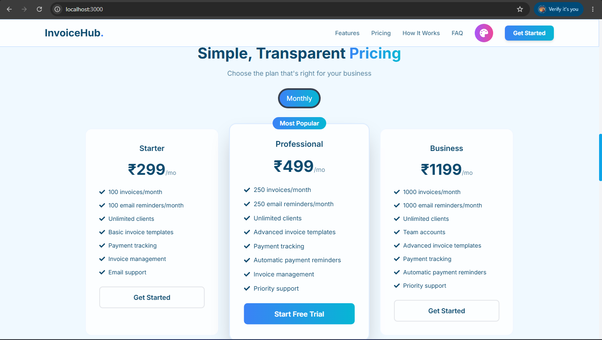
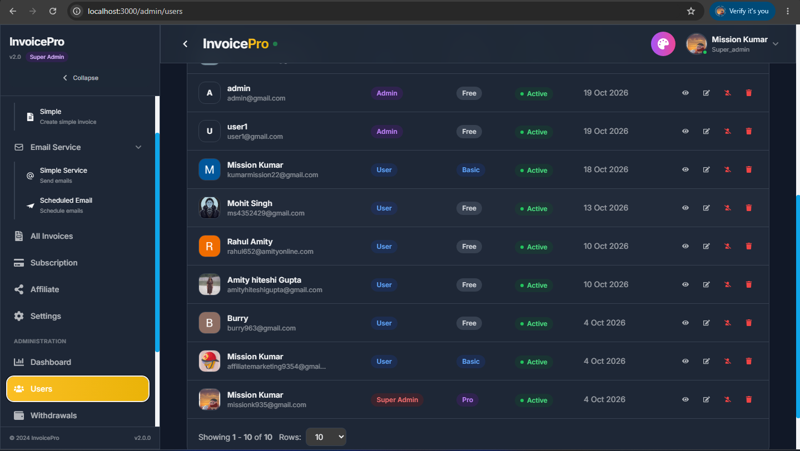
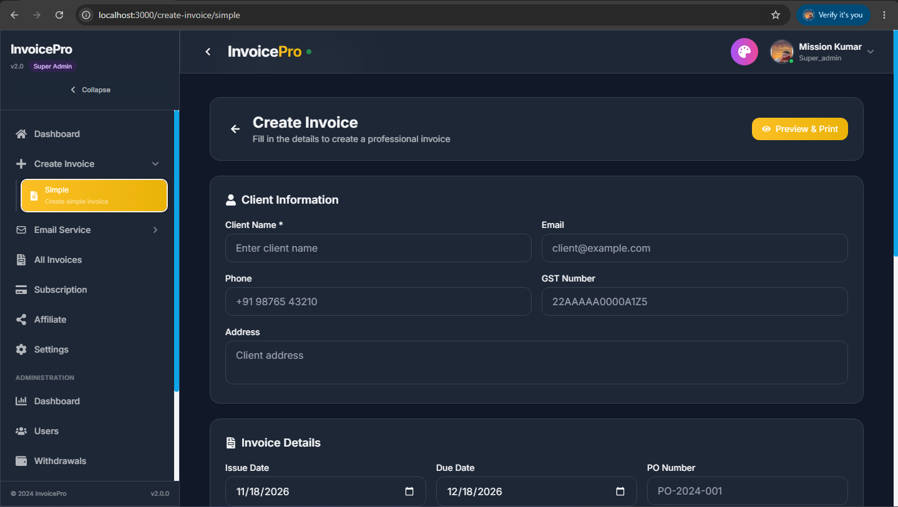
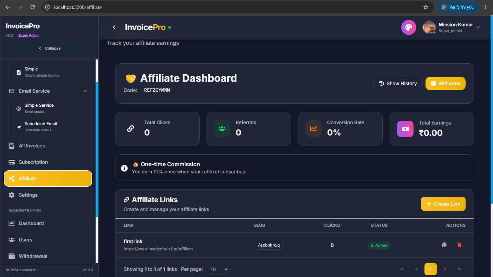
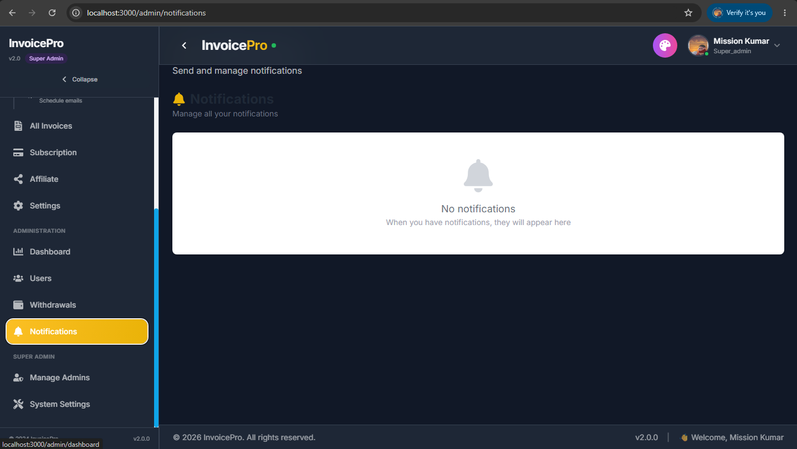
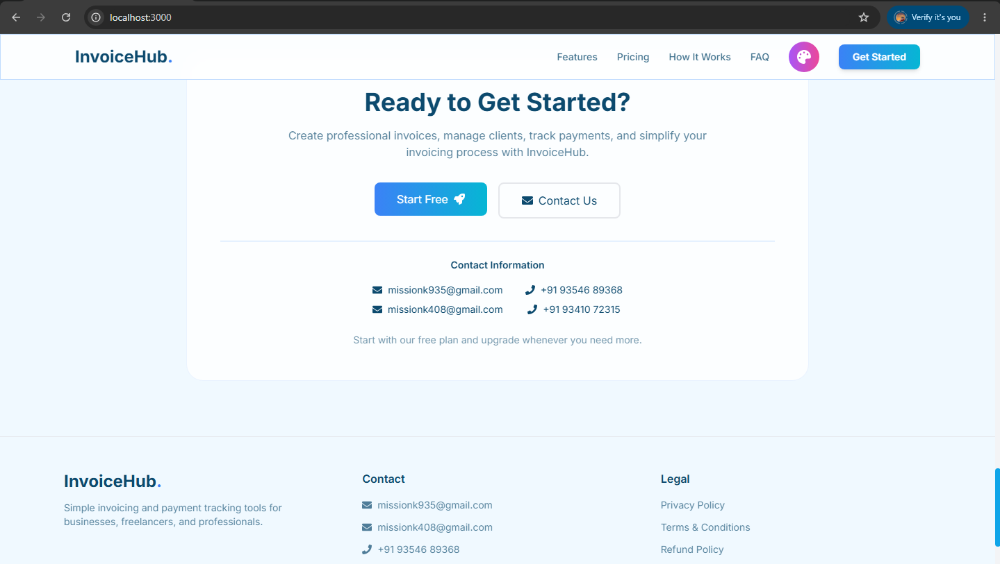
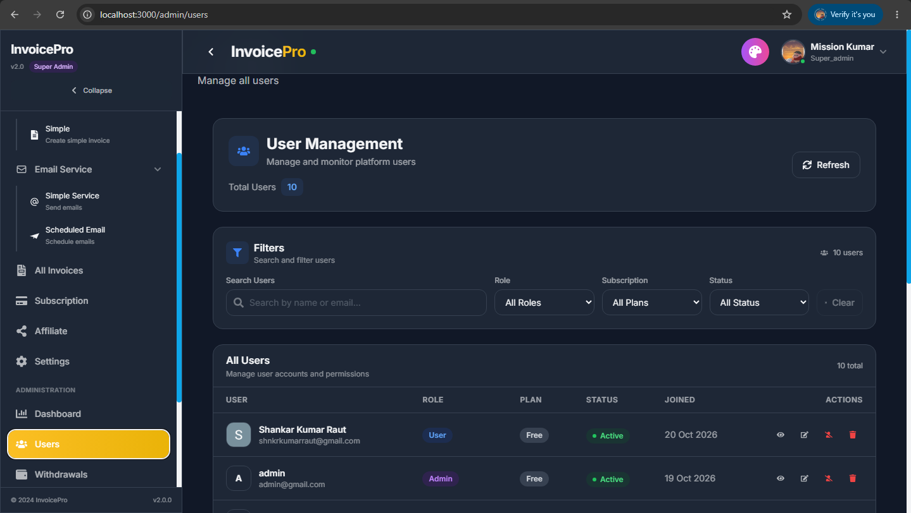

Aap is pure code ko copy karke apni README.md file mein paste kar dein:

markdown
# 🚀 InvoicePro - SaaS Invoice Generator

A complete SaaS platform for generating professional invoices with user, admin, moderator, and affiliate roles. Features subscription plans, email reminders, and a 10% affiliate commission system.

## 🚀 Project Repository
[GitHub Repo](https://github.com/missionkuamar/Invoice-saas-vps-for-production.git)

---

## 📸 Screenshots

### 🏠 Landing Page & Features


### 💰 Pricing Plans



### 📊 User Dashboard & Invoicing





### 📧 Email System, Affiliate & Notifications






### 🛡️ Admin & Super-Admin Panel




---

## 📋 Features

### 👤 User Roles
- **Admin** - Full control over users, invoices, payments, and system settings.
- **Moderator** - Manage invoices, users, and content moderation.
- **Affiliate** - Refer users and earn 10% commission on subscriptions.
- **User** - Create and manage invoices, subscribe to plans.

### 📄 Invoice Management
- Create professional invoices with multiple templates.
- Add company and client details dynamically.
- Add items with quantity, rate, discount, and tax (GST).
- Generate and download PDF invoices using Puppeteer.
- Invoice tracking and complete history.

### 💰 Subscription Plans

| Plan | Price | Invoices/Month | Emails/Month | Features |
|------|-------|----------------|--------------|----------|
| **Free** | ₹0 | 5 | - | Basic invoice creation, 1 template |
| **Basic** | ₹299/month | 100 | 100 | PDF export, Email support |
| **Pro** | ₹499/month | 250 | 250 | Analytics, Priority support, Custom branding |
| **Enterprise** | ₹1199/month | 1000 | 1000 | White-label, Dedicated support, Custom features |

### How Subscription Works
1. User signs up with Free plan (5 free invoices).
2. User chooses a plan (Basic/Pro/Enterprise).
3. Payment via Razorpay gateway.
4. Subscription activated immediately.
5. User can create invoices based on their plan limits.
6. Monthly renewal - automatic payment.
7. Email reminder sent 5 days before renewal.
8. If payment fails, plan downgraded to Free.

### 🤝 Affiliate Program
- **10% commission** on every referral subscription.
- Example: If you refer someone who buys Pro plan (₹499), you earn ₹49.9.
- If they buy Enterprise (₹1199), you earn ₹119.9.
- Recurring commission - you earn every month they stay subscribed.
- Custom affiliate links with tracking and clicks.
- Withdraw earnings via Bank/UPI/PayPal (minimum ₹500).

### 📧 Email System
- **Invoice Reminder** - 3 days before due date.
- **Subscription Reminder** - 5 days before renewal.
- **Welcome Email** - New user registration.
- **Payment Confirmation** - After successful payment.
- **Affiliate Commission** - "You earned ₹XX from referral".

---

## 🛠️ Tech Stack

### Backend
- **Node.js + Express.js** - Server & API
- **MongoDB** - Database
- **JWT** - Authentication
- **Razorpay** - Payment gateway
- **Cloudinary** - Image upload
- **Nodemailer** - Email system
- **Node-cron** - Task scheduling (Emails)
- **Puppeteer** - PDF generation

### Frontend
- **React.js (Vite)** - UI Library
- **Redux Toolkit** - State management
- **Tailwind CSS** - Styling
- **React Router DOM** - Routing
- **React Hot Toast** - Notifications

---

## 📁 Project Structure

```text
invoice-saas/
├── client/                  # React Frontend
│   ├── public/              # Static files & Screenshots
│   ├── src/                 # React source code
│   │   ├── components/
│   │   ├── pages/
│   │   └── store/
│   └── package.json
├── server/                  # Node.js Backend
│   ├── src/
│   │   ├── config/
│   │   ├── models/
│   │   ├── controllers/
│   │   ├── routes/
│   │   ├── middleware/
│   │   ├── cron/
│   │   └── server.js
│   └── package.json
├── docker-compose.yml
└── README.md
⚡ Installation & Setup
1. Clone the Repository
bash
git clone https://github.com/missionkuamar/Invoice-saas-vps-for-production.git
cd Invoice-saas-vps-for-production
2. Backend Setup (server folder)
bash
cd server
npm install
Create a .env file in the server folder and add the following variables:

env
# Server Configuration
PORT=5000
NODE_ENV=development

# Database
MONGODB_URI=your_mongodb_connection_string

# Authentication & Security
JWT_SECRET=your_jwt_secret_key
SESSION_SECRET=your_session_secret_key

# Google OAuth
GOOGLE_CLIENT_ID=your_google_client_id
GOOGLE_CLIENT_SECRET=your_google_client_secret

# URL Configuration
FRONTEND_URL=http://localhost:3000
CLIENT_URL=http://localhost:3000

# Razorpay (Payment Gateway)
RAZORPAY_KEY_ID=your_razorpay_key_id
RAZORPAY_KEY_SECRET=your_razorpay_key_secret

# Email (Gmail / SMTP)
EMAIL_USERNAME=your_email@gmail.com
EMAIL_PASSWORD=your_app_password

# Puppeteer (PDF Generation)
PUPPETEER_EXECUTABLE_PATH=/path/to/chrome/executable
Start the backend server:

bash
npm run dev
3. Frontend Setup (client folder)
Open a new terminal and navigate to the client folder:

bash
cd client
npm install
Create a .env file in the client folder and add the following variables:

env
# API & Backend URLs
VITE_API_URL=http://localhost:5000/api
VITE_BACKEND_URL=http://localhost:5000
VITE_FRONTEND_URL=http://localhost:3000

# Google OAuth
VITE_GOOGLE_CLIENT_ID=your_google_client_id

# Razorpay
VITE_RAZORPAY_KEY_ID=your_razorpay_key_id
Start the frontend server:

bash
npm run dev
4. Access the Application
Open your browser and visit: http://localhost:3000 (or whichever port Vite provides).

🔑 Environment Variables Explained
Yahan dono .env files ke variables ka detail diya gaya hai:

🖥️ Server .env Variables
Variable	Description	Example
PORT	The port on which the backend server runs.	5000
NODE_ENV	Environment mode (development/production).	development
MONGODB_URI	Your MongoDB connection string (Local or Atlas).	mongodb://localhost:27017/invoice
JWT_SECRET	Secret key used to sign JWT authentication tokens.	your_super_secret_key
SESSION_SECRET	Secret key for express sessions.	session_secret_key
GOOGLE_CLIENT_ID	Google OAuth Client ID for backend verification.	xxxx.apps.googleusercontent.com
GOOGLE_CLIENT_SECRET	Google OAuth Client Secret.	GOCSPX-xxxx
FRONTEND_URL	URL of the frontend (for CORS and Email links).	http://localhost:3000
CLIENT_URL	Same as FRONTEND_URL, used for redirections.	http://localhost:3000
RAZORPAY_KEY_ID	Razorpay API Key ID for creating orders.	rzp_test_xxxx
RAZORPAY_KEY_SECRET	Razorpay API Key Secret for verifying payments.	xxxx
EMAIL_USERNAME	Your Gmail address for sending emails.	your_email@gmail.com
EMAIL_PASSWORD	Gmail App Password (Not your normal password).	abcd efgh ijkl mnop
PUPPETEER_EXECUTABLE_PATH	Path to Chrome executable if not bundled with Puppeteer.	/usr/bin/google-chrome
💻 Client .env Variables
Variable	Description	Example
VITE_API_URL	The base URL for all API requests (includes /api).	http://localhost:5000/api
VITE_BACKEND_URL	The base URL for the backend server (without /api).	http://localhost:5000
VITE_FRONTEND_URL	The frontend URL (used for redirects).	http://localhost:3000
VITE_GOOGLE_CLIENT_ID	Google OAuth Client ID for frontend login button.	xxxx.apps.googleusercontent.com
VITE_RAZORPAY_KEY_ID	Razorpay Key ID for opening the payment popup.	rzp_test_xxxx
🔌 API Endpoints
Authentication
text
POST   /api/auth/register      - Register user
POST   /api/auth/login         - Login user
GET    /api/auth/profile       - Get profile
PUT    /api/auth/profile       - Update profile
Invoices
text
GET    /api/invoices           - Get all invoices
POST   /api/invoices           - Create invoice
GET    /api/invoices/:id       - Get single invoice
PUT    /api/invoices/:id       - Update invoice
DELETE /api/invoices/:id       - Delete invoice
Subscriptions
text
GET    /api/subscriptions/plans - Get all plans
POST   /api/subscriptions/order - Create Razorpay order
POST   /api/subscriptions/verify - Verify payment
POST   /api/subscriptions/cancel - Cancel subscription
GET    /api/subscriptions/status - Check subscription status
Affiliate
text
POST   /api/affiliate/join     - Join affiliate program
GET    /api/affiliate/dashboard - Get dashboard stats
POST   /api/affiliate/links    - Create affiliate link
GET    /api/affiliate/links    - Get all links
POST   /api/affiliate/withdraw - Request withdrawal
GET    /api/affiliate/withdrawals - Get withdrawal history
Admin
text
GET    /api/admin/stats        - Dashboard stats
GET    /api/admin/users        - Get all users
PUT    /api/admin/users/:id    - Update user role
DELETE /api/admin/users/:id    - Delete user
GET    /api/admin/withdrawals  - Get all withdrawals
PUT    /api/admin/withdrawals/:id - Process withdrawal
Email Reminders (Scheduled)
text
# Runs automatically via cron job every day at 9 AM
GET    /api/email/reminders    - Get all reminders
POST   /api/email/send-manual  - Send manual reminder
📧 Email Reminders System
Scheduled Tasks (Runs daily at 9 AM via Node-Cron):

Invoice Due Reminder: Checks invoices due in 3 days, sends email to client and user.

Subscription Renewal: Checks subscriptions expiring in 5 days, sends renewal reminder with payment link.

Payment Confirmation: Sent immediately after successful payment, includes invoice/download link.

Affiliate Commission: Sent when a referral completes payment ("You earned ₹XX from referral").

💳 Payment Flow
text
1. User visits subscription page.
2. Selects plan (Basic/Pro/Enterprise).
3. Clicks "Subscribe".
4. Razorpay payment popup opens.
5. User completes payment.
6. Backend verifies payment signature.
7. Subscription activated in database.
8. Email confirmation sent to user.
9. Affiliate gets commission (if referred).
10. Subscription auto-renews monthly.
11. Email reminder sent 5 days before renewal.
🏦 Affiliate Withdrawal Process
text
1. Affiliate earns commissions from referrals.
2. Dashboard shows total earnings.
3. Affiliate requests withdrawal (min ₹500).
4. Admin receives notification in dashboard.
5. Admin reviews and approves.
6. Admin processes payment manually.
7. Affiliate receives payment.
8. Status updated to "Completed".
🚀 Deployment
Backend (Render / Railway)
Push your code to GitHub.

Connect your repository to Render.

Add all the server .env variables in the Render dashboard.

Set Build Command: npm install and Start Command: npm start or node src/server.js.

Frontend (Vercel / Netlify)
Run npm run build in the client folder.

Deploy the dist folder to Vercel/Netlify.

Add all the client .env variables in the deployment dashboard.

Ensure the VITE_API_URL points to your live backend URL.

📦 Key Dependencies
Backend:

text
express, mongoose, bcryptjs, jsonwebtoken,
razorpay, cloudinary, nodemailer, node-cron,
puppeteer, cors, dotenv
Frontend:

text
react, react-redux, @reduxjs/toolkit,
react-router-dom, axios, tailwindcss, react-hot-toast
📄 License
MIT License

👨‍💻 Author
Mission Kumar

GitHub: @missionkuamar

Repository: Invoice-saas-vps-for-production

⭐ Star this repository if you found it helpful!