# 🚀 InvoicePro - SaaS Invoice Generator

A complete SaaS platform for generating professional invoices with user, admin, moderator, and affiliate roles. Features subscription plans, email reminders, and a 10% affiliate commission system.

## 🚀 Project Repository
[GitHub Repo](https://github.com/missionkuamar/Invoice-saas-vps-for-production.git)

---

## 📸 Screenshots

### 🏠 Landing Page & Features
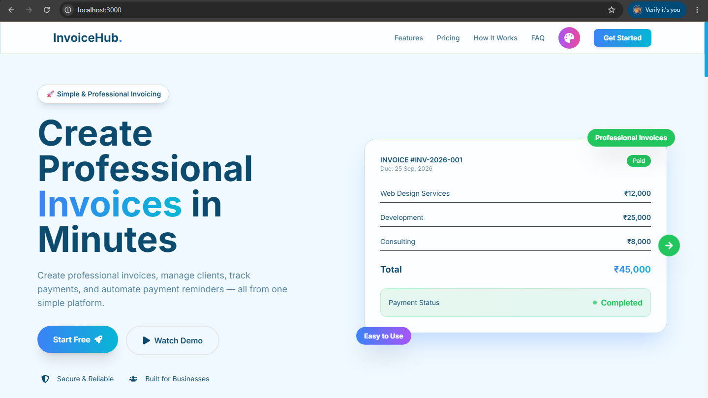
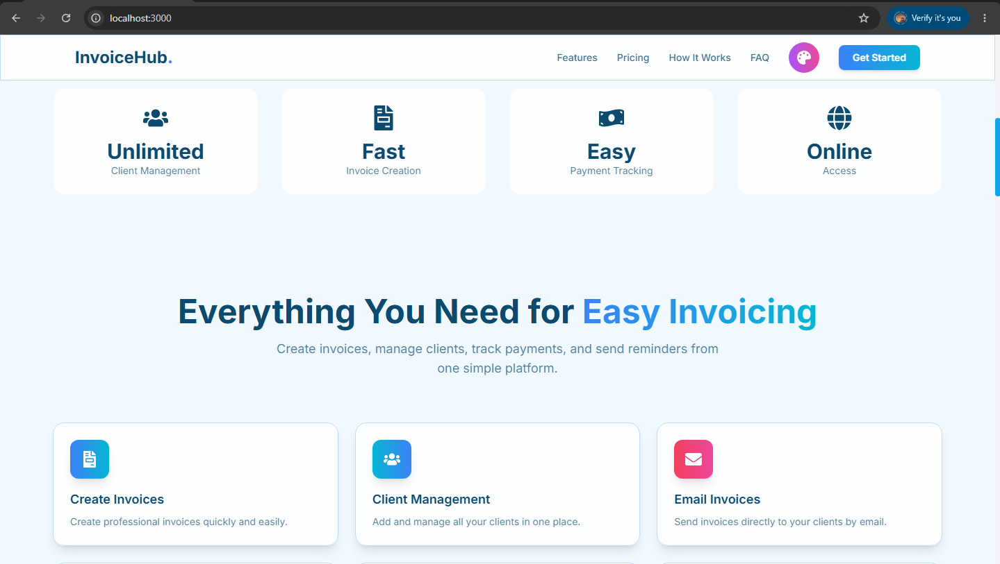
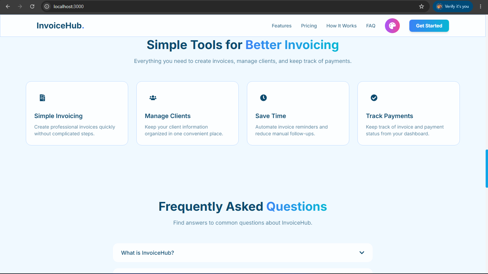

### 💰 Pricing Plans

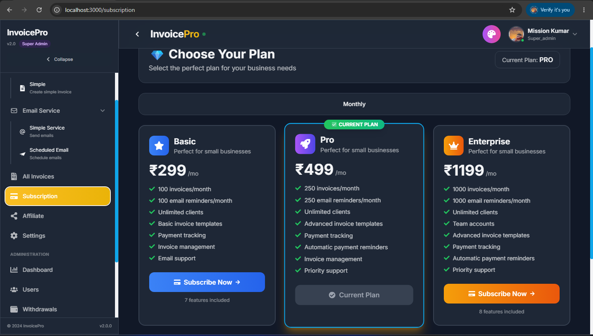

### 📊 User Dashboard & Invoicing
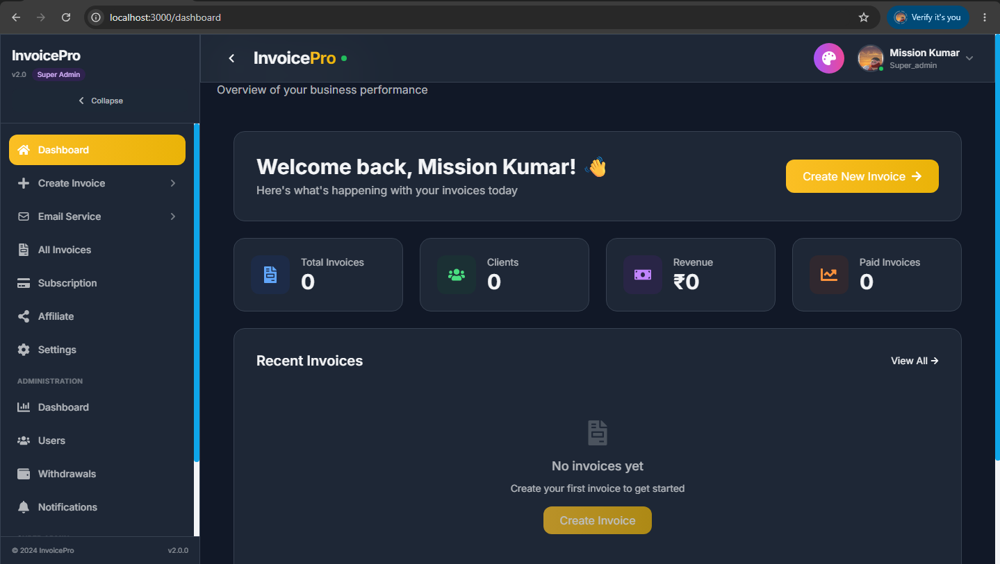

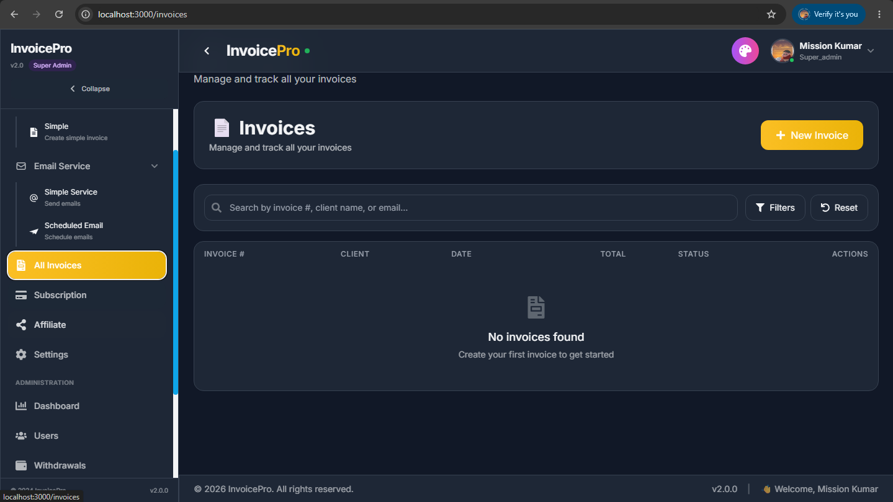
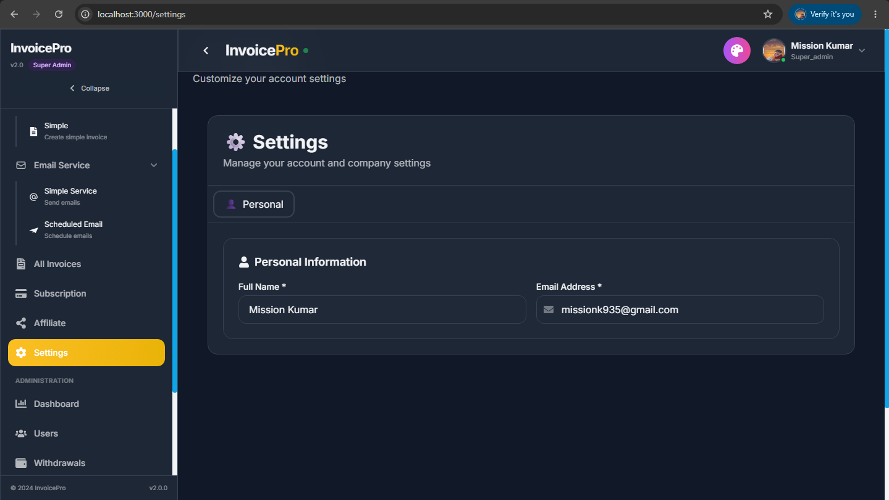

### 📧 Email System & Affiliate
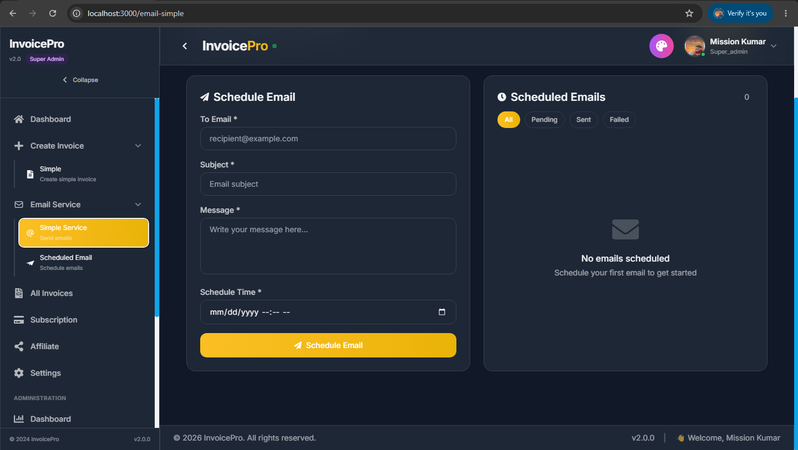
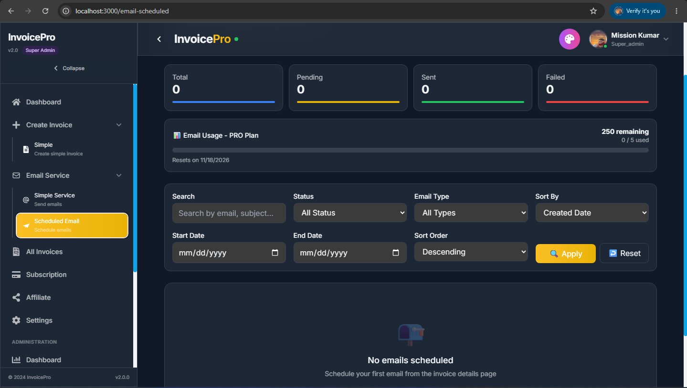


### 🛡️ Admin & Super-Admin Panel
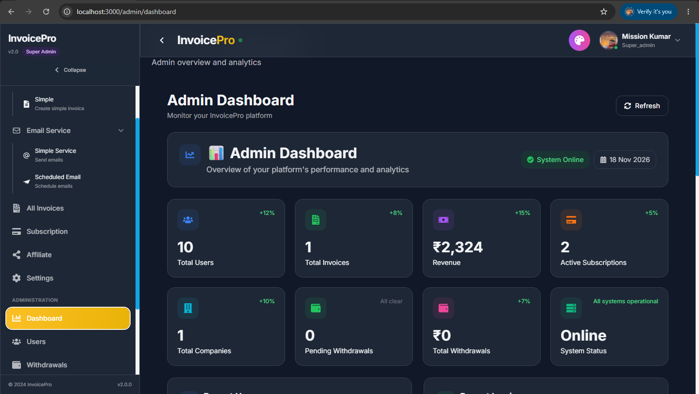

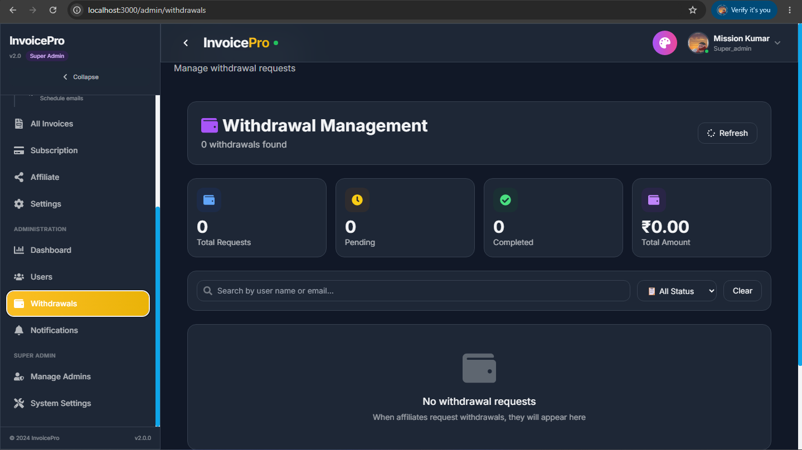

---

## 📋 Features

### 👤 User Roles
- **Admin** - Full control over users, invoices, payments, and system settings
- **Moderator** - Manage invoices, users, and content moderation
- **Affiliate** - Refer users and earn 10% commission on subscriptions
- **User** - Create and manage invoices, subscribe to plans

### 📄 Invoice Management
- Create professional invoices with multiple templates
- Add company and client details
- Add items with quantity, rate, and tax
- Generate and download PDF invoices
- Invoice tracking and history

### 💰 Subscription Plans

| Plan | Price | Invoices/Month | Emails/Month | Features |
|------|-------|----------------|--------------|----------|
| **Free** | ₹0 | 5 | - | Basic invoice creation, 1 template |
| **Basic** | ₹299/month | 100 | 100 | PDF export, Email support |
| **Pro** | ₹499/month | 250 | 250 | Analytics, Priority support, Custom branding |
| **Enterprise** | ₹1199/month | 1000 | 1000 | White-label, Dedicated support, Custom features |

### How Subscription Works
1. User signs up with Free plan (5 free invoices)
2. User chooses a plan (Basic/Pro/Enterprise)
3. Payment via Razorpay
4. Subscription activated immediately
5. User can create invoices based on their plan limits
6. Monthly renewal - automatic payment
7. Email reminder sent 5 days before renewal
8. If payment fails, plan downgraded to Free

### 🤝 Affiliate Program
- **10% commission** on every referral subscription
- Example: If you refer someone who buys Pro plan (₹499), you earn ₹49.9
- If they buy Enterprise (₹1199), you earn ₹119.9
- Recurring commission - you earn every month they stay subscribed
- Custom affiliate links with tracking
- Withdraw earnings via Bank/UPI/PayPal (minimum ₹500)

### 📧 Email System
- **Invoice Reminder** - 3 days before due date
- **Subscription Reminder** - 5 days before renewal
- **Welcome Email** - New user registration
- **Payment Confirmation** - After successful payment
- **Affiliate Commission** - "You earned ₹XX from referral"

---

## 🛠️ Tech Stack

### Backend
- **Node.js + Express.js** - Server
- **MongoDB** - Database
- **JWT** - Authentication
- **Razorpay** - Payment gateway
- **Cloudinary** - Image upload
- **Nodemailer** - Email system
- **Node-cron** - Email scheduling

### Frontend
- **React.js** - UI
- **Redux Toolkit** - State management
- **Tailwind CSS** - Styling
- **Vite** - Build tool

---

## 📁 Project Structure

```text
invoice-saas/
├── client/                  # React Frontend
│   ├── public/              # Static files & Screenshots
│   ├── src/                 # React source code
│   │   ├── components/
│   │   ├── pages/
│   │   └── store/
│   └── package.json
├── server/                  # Node.js Backend
│   ├── src/
│   │   ├── config/
│   │   ├── models/
│   │   ├── controllers/
│   │   ├── routes/
│   │   ├── middleware/
│   │   ├── cron/
│   │   └── server.js
│   └── package.json
├── docker-compose.yml
└── README.md